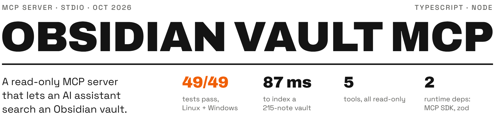

<picture>
  <source media="(max-width: 600px) and (prefers-color-scheme: dark)" srcset=".github/assets/header-phone-dark.png">
  <source media="(max-width: 600px) and (prefers-color-scheme: light)" srcset=".github/assets/header-phone-light.png">
  <source media="(prefers-color-scheme: dark)" srcset=".github/assets/header-dark.png">
  <source media="(prefers-color-scheme: light)" srcset=".github/assets/header-light.png">
  
</picture>

A small [Model Context Protocol](https://modelcontextprotocol.io) server, written in TypeScript for Node.js, that gives an AI assistant full-text search, notes with parsed frontmatter, tags, backlinks and outgoing links from an Obsidian vault. It talks over stdio, has no write tools, makes no network calls and has no telemetry, so a personal vault can be used as context without handing anything else over.

[Portfolio page](https://damanjz.github.io/portfolio/projects/obsidian-vault-mcp/) · [](https://github.com/damanjz/obsidian-vault-mcp/actions/workflows/ci.yml)

## Results

| Figure | Result | How it is produced |
|---|---|---|
| 49/49 tests | Pass on Node 20 and 22, on Ubuntu and Windows | `npm test` (`node:test`); CI run [37829133841](https://github.com/damanjz/obsidian-vault-mcp/actions/runs/37829133841), 2026-10-08 |
| 87 ms | To index a real 215-note vault | Measured on the author's vault, 2026-10-09; the server prints its index time to stderr at startup (`src/index.ts`). See [Measurement](#measurement) |
| 5 tools | `search`, `read_note`, `backlinks`, `outgoing_links`, `list_notes`; every one annotated `readOnlyHint: true` | `src/server.ts`; see [Tools](#tools) |
| 2 runtime dependencies | `@modelcontextprotocol/sdk` and `zod` | `package.json` |
| 3 to 12 ms | Per search on the same 215-note vault | See [Measurement](#measurement) |

## How it works

- **Read-only.** There are no write tools. The code only calls `readdir`, `stat`, `realpath` and `readFile`, and a test enforces that.
- **Local.** It talks over stdio. It makes no network calls and has no telemetry. stdout carries the MCP protocol only; diagnostics go to stderr.
- **Obsidian-aware.** It understands `[[Note|alias]]`, `[[Note#Heading]]`, `![[embeds]]`, Markdown links, frontmatter `tags`/`aliases` and inline `#tags`, including nested tags. It resolves links the way Obsidian does.
- **Small.** There is no search engine library. Ranking is BM25 over an in-memory index, and only changed files are re-read.

## Tools

Every tool is annotated `readOnlyHint: true` and `openWorldHint: false`, and returns JSON text. Paths are relative to the vault and use forward slashes. Where a tool takes `note`, you can give a path (`Projects/Plan.md` or `Projects/Plan`), a title (`Plan`) or a frontmatter alias.

| Tool | Arguments | Returns |
| --- | --- | --- |
| `search` | `query`, `limit` (default 10, max 100), `folder`, `tag` | Notes ranked by relevance, each with path, title, tags, score and up to 3 matching lines with line numbers |
| `read_note` | `note`, `max_chars` (default 40,000, max 200,000) | Parsed frontmatter, tags, aliases, body and a `truncated` flag. If notes share a title, the others are listed in `otherMatches` |
| `backlinks` | `note`, `limit` (default 200) | Notes linking to the note, with line, raw link, alias, heading or block subpath, embed flag and context |
| `outgoing_links` | `note` | Each link marked as resolved (note or attachment path) or unresolved, with resolved and unresolved counts |
| `list_notes` | `folder`, `tag`, `limit` (default 200, max 2,000) | Notes sorted by path, with tags and modified time |

**Search syntax.** Search ignores case and every word must match. `"quoted phrase"` matches the exact phrase. `#tag` filters by tag. Example: `budget "q3 plan" #work`. Matches in the title or an alias rank higher.

**Tags** come from frontmatter (`tags`/`tag`, as a list or a string) and from inline `#tags`. Matching ignores case and includes nested tags, so `project` also matches `project/alpha`. A tag made only of digits (`#123`) is not a tag, and neither is anything inside code.

**Links** count wikilinks, embeds, internal Markdown links (`[text](Other%20Note.md)`) and wikilinks inside frontmatter properties. Links inside code blocks and inline code are ignored. A link resolves in this order:

1. The exact vault path.
2. The note with that name in the linking note's own folder.
3. The shortest path, then alphabetical order.

## Security

- The vault root is resolved to its real path once at startup.
- `..` paths, absolute paths outside the vault, and NUL bytes are refused with an "outside the vault" error. Absolute paths inside the vault work.
- Any file or folder whose name starts with a dot (`.obsidian`, `.trash`, `.git`) is skipped and cannot be read.
- Symlinks and junctions are resolved, and anything whose real path is outside the vault is ignored. Each file's real path is checked again right before it is read. Symlink loops are followed only once.
- Tool input never becomes a filesystem path. Notes are served from the in-memory index, which holds only files that passed these checks.
- Notes larger than 5 MB are skipped. Responses are capped by the `limit` and `max_chars` arguments.
- The index reloads from disk at most every 2 seconds, and only re-reads files whose size or modified time changed.

## Measurement

Measured on 2026-10-09 against the author's own Obsidian vault (not in this repo):

| What | Result |
|---|---|
| Notes indexed at startup | 215 notes in 87 ms |
| `search` calls | 3 to 12 ms each |
| `backlinks` for the vault's home note | 33 notes, 48 links; matched an independent count |

To measure your own vault, start the server on it: the startup line on stderr reports the note count and the index time. On the bundled sample vault it reads `[obsidian-vault-mcp] vault <path>: 12 notes, 1 other files indexed in 10 ms` (Windows 11, Node 24, 2026-10-12).

## Tests

`npm test` runs 49 tests with Node's built-in `node:test` ([latest CI run](https://github.com/damanjz/obsidian-vault-mcp/actions/workflows/ci.yml)). They cover:

- Frontmatter and link parsing.
- Link resolution.
- Every tool.
- Path-traversal and symlink attempts.
- Unicode.
- An end-to-end run that starts the server over stdio and calls every tool through the MCP SDK client.

## Quick start

Needs Node.js 20 or newer.

```sh
git clone https://github.com/damanjz/obsidian-vault-mcp.git
cd obsidian-vault-mcp
npm install
npm run build                            # compile src/ to dist/
npm test                                 # compile src/ and test/, then run all tests
node dist/index.js examples/sample-vault # try it against the bundled sample vault
```

Give it the vault path as the first argument or in the `VAULT_PATH` environment variable. Use absolute paths.

**Claude Code**

```sh
claude mcp add obsidian-vault -- node /abs/path/obsidian-vault-mcp/dist/index.js "/abs/path/to/vault"
```

**Claude Desktop** (`claude_desktop_config.json`), or a project `.mcp.json`:

```json
{
  "mcpServers": {
    "obsidian-vault": {
      "command": "node",
      "args": ["/abs/path/obsidian-vault-mcp/dist/index.js"],
      "env": { "VAULT_PATH": "/abs/path/to/vault" }
    }
  }
}
```

On Windows, write paths as `C:/Users/you/Vault` or escape each backslash (`C:\\Users\\you\\Vault`).

## Repo layout

```
obsidian-vault-mcp/
├── src/
│   ├── index.ts        # entry point: reads the vault path, builds the index, starts stdio
│   ├── server.ts       # MCP tool registration, zod input schemas, read-only annotations
│   ├── tools.ts        # tool implementations and limits (BM25 search, links, listing)
│   ├── vault.ts        # in-memory index, walker and path security checks
│   └── markdown.ts     # frontmatter, wikilink, Markdown link, embed and tag parsing
├── test/               # node:test suites, including the end-to-end stdio run
├── examples/sample-vault/  # small vault of invented notes used by the tests
└── .github/workflows/ci.yml  # Node 20 and 22 on Ubuntu and Windows
```

## Limits

- Read-only by design: it cannot create, edit, move or delete notes.
- Search is keyword-based (BM25), not semantic; there are no embeddings.
- The 87 ms and 3 to 12 ms figures come from one vault on one machine; times grow with vault size.
- Notes larger than 5 MB and everything in dot-folders are skipped.

## Licence

MIT, see [LICENSE](LICENSE).
